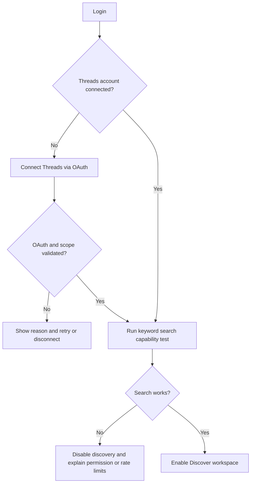
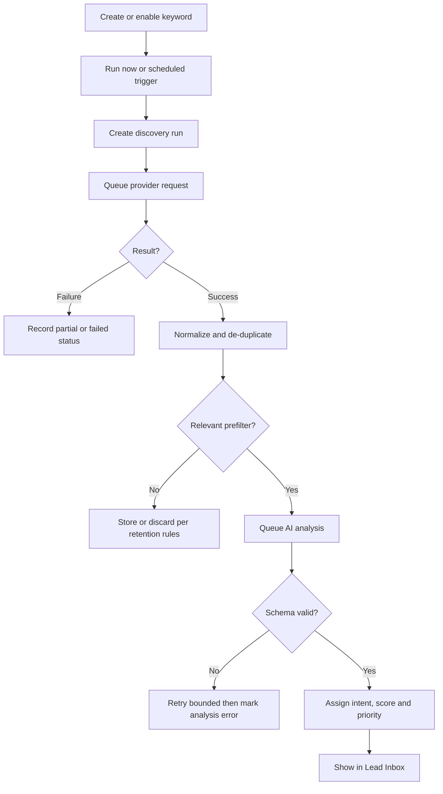
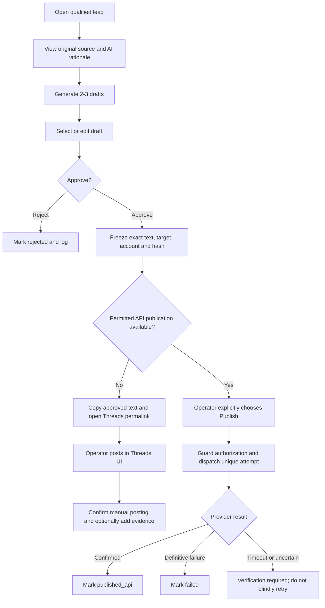

# RisenDev Growth Assistant — User Flow & State Machines

**Primary actor:** internal RisenDev operator. **System actors:** scheduler, Threads integration, AI provider, worker.  
**Rule:** external data is untrusted; no action sends a comment without approval.

## 1. Information architecture
```text
Authenticated Workspace
├── Overview
├── Discover
│   ├── Keywords (manage)
│   ├── Run Discovery
│   └── Run History & Errors
├── Lead Inbox
│   ├── Filters, Search, Sort
│   └── Lead Detail
│       ├── Original Post & Permalink
│       ├── AI Analysis / Score
│       ├── Notes / Lead status
│       └── Generate Draft
├── Review Queue
│   ├── Draft Variants
│   ├── Edit & Preview
│   ├── Approve / Reject
│   └── Copy / Open Post / Publish (conditional)
├── Activity
└── Settings
    ├── Social Connection
    ├── AI Configuration
    └── Retention & Security
```

## 2. Onboarding / API capability


## 3. Discovery and qualification


## 4. Review and engagement (MVP)


## 5. Detailed screens and states
### Connection
- Empty: “Hubungkan akun Threads untuk memulai pencarian.” CTA Connect.
- Connecting: progress, no false connection claim.
- Connected: account handle, scopes, token health, last check.
- Restricted: permission missing; explanatory checklist and retry.
- Disconnected/expired: discovery paused; previously saved data visible under retention policy.

### Keyword management
- Fields: phrase (required), category (`direct_demand`, `business_problem`, `community`), search type (`RECENT`, `TOP`), enabled, optional interval and notes.
- Duplicate normalized phrase/category/platform blocked or merged.
- Run-now disabled when account scope invalid; preview last run.

### Lead Inbox
- Default sort high-intent first, with recency tie-break.
- Filter: intent, priority, status, date, service category, keyword.
- Post card: author, text excerpt, date, matched keyword, score **as prioritization not certainty**, rationale preview.
- Actions: open source, save for review, archive, skip, generate draft.
- Empty state: “Belum ada postingan yang sesuai. Coba kata kunci yang lebih spesifik.”

### Draft review
- Source post and permalink visible while drafting.
- Variants: friendly (default), professional, casual; editable full text.
- Show character constraints according to target platform and verified API.
- Buttons: Save Draft, Regenerate, Reject, Approve.
- After approval: show immutable approved version; **Edit** creates new draft revision requiring approval.
- Publishing options separated: Copy & Open (MVP); Publish via API only if capability confirmed.

### Activity
- Show `approved`, `copied`, `manual_posted`, `publishing`, `published_api`, `failed`, `verification_required` distinctly.
- Filter by operator, lead, date, channel and delivery method.
- Do not use a success toast claiming publication for copy-to-clipboard.

## 6. Core state machines
### Discovery run
`queued -> running -> completed | partial | failed | cancelled`.  
Retry creates a new attempt or controlled retry metadata; never silently resets completed run.

### Lead
`new -> qualified | low_priority | irrelevant -> in_review -> engaged | archived`.
Manual override allowed; no automatic outgoing engagement.

### Draft
`draft -> pending_review -> approved | rejected`.
Editing approved or pending text creates a new `draft` revision, invalidating prior approval for publication.

### Engagement attempt
`pending -> publishing -> published_api | failed | verification_required`; manual flow: `approved -> copied -> manual_posted` as event history. `verification_required` requires investigation, not automatic resend.

## 7. Validation and edge cases
| Case | Expected behavior |
|---|---|
| Multiple runs return same post | Reuse discovered post; add discovery-run provenance |
| Same account scopes revoked | Stop queued outgoing actions; show restricted status |
| AI claims unrelated promotion | User can edit; no auto-publish |
| Draft changed after approval | Must approve again with new hash |
| Network times out after reply request | Mark verification required; reconcile using provider evidence |
| 429 / provider limits | Delay job; show partial run; throttle per account |
| Post deleted/private after discovery | Disable/avoid publish; show source unavailable |
| User presses approve twice | Transactional guard; one approval for exact revision |
| User copies text but never posts | Stay `copied`, do not count as published |
| User disconnects account | Revoke if supported and invalidate local token; pause runs |

## 8. Mobile navigation
- Bottom nav for Overview, Inbox, Review, Activity with overflow to Discover/Settings OR compact top nav; **do not duplicate navigation surfaces**.
- Lead detail uses stacked layout; sticky review action appears only with contextual need.
- Review composer supports keyboard and screen reader; never hide source post permanently.

## 9. User acceptance scenarios
1. Connected operator creates `butuh website`, runs discovery, sees relevant permalink in Inbox.
2. AI marks learning/tutorial post as low priority and direct quote request as high intent.
3. Operator edits friendly draft, approves exact revision, copies, opens original, confirms manual posting.
4. Operator edits an approved draft: previous approval cannot be reused.
5. Provider scope expires: app clearly shows error, retains safe history, queues no new API publishing.
6. Double request/race condition cannot create two verified outgoing comments for one explicit dispatch.
