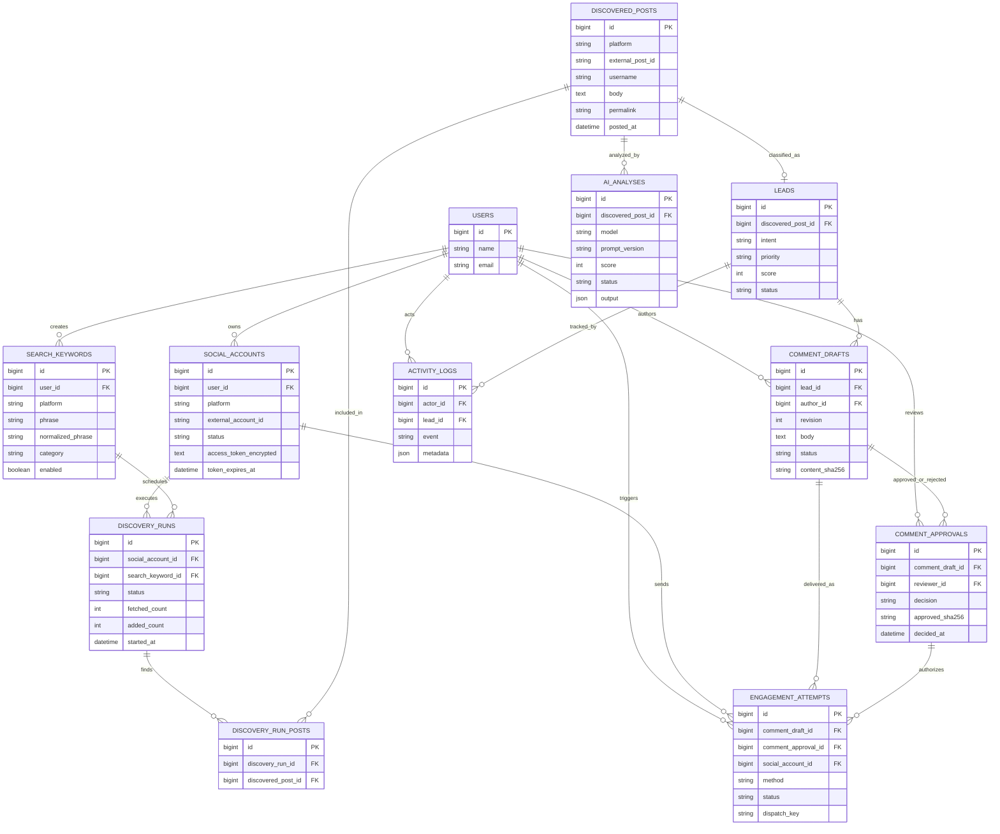

# RisenDev Growth Assistant — Entity Relationship Diagram (ERD)

**Scope:** single-operator internal MVP, extensible for more operators; **not** multi-tenant SaaS yet.  
**Canonical data schema:** see `05-DB-MIGRASI.md`.

## 1. ERD

## 2. Cardinality and invariants
| Relationship | Rule |
|---|---|
| User → social accounts | One user can connect multiple accounts; MVP uses one Threads account |
| Keyword → discovery runs | Each run belongs to exactly one keyword and account |
| Run ↔ post | Many-to-many via pivot; repeated discovery does not clone posts |
| Post → lead | Zero or one lead per discovered post |
| Post → AI analyses | Multiple analyses permit model/prompt re-evaluation |
| Lead → comment drafts | Many drafts, including revisions and tones |
| Draft → approvals | Multiple historical decisions allowed; only **latest valid approval for exact revision/hash** may authorize send |
| Approval → engagement attempts | Attempt must reference an approved snapshot and matching account/target |
| Lead → logs | Timeline stores key actions; actor nullable for system events |

## 3. Unique constraints
- `social_accounts(platform, external_account_id, user_id)`.
- `search_keywords(user_id, platform, normalized_phrase, category)`.
- `discovered_posts(platform, external_post_id)`.
- `discovery_run_posts(discovery_run_id, discovered_post_id)`.
- `leads(discovered_post_id)`.
- `comment_drafts(lead_id, variant_key, revision)`.
- `engagement_attempts(dispatch_key)`.
- `comment_approvals`: no uniqueness on draft ID, to preserve decision history; validate current approval transactionally.

## 4. Notes on data lifecycles
- Deleting a keyword must preserve historical run provenance or soft-delete keywords (preferred).
- Revoking a social account should revoke/clear token and mark inactive rather than cascade-delete engagement history.
- Posts from a platform may disappear; store last fetched snapshot only as permitted and follow retention obligations.
- External IDs are **strings**, not integers, to avoid overflow/format problems.
- Engagement attempt should capture exact `target_external_post_id`, approved text digest, and provider receipt for reconciliation; never rely on mutable draft text.
- Auth/queue/cache tables generated by Laravel are infrastructure tables omitted from domain ERD.

## 5. Index strategy
- `discovered_posts`: `(platform, posted_at)`, `(username)` optional.
- `leads`: `(priority, score)`, `(status, created_at)`, `(intent)`.
- `discovery_runs`: `(status, created_at)`, `(search_keyword_id, created_at)`.
- `comment_drafts`: `(status, created_at)`, `(lead_id, created_at)`.
- `engagement_attempts`: `(status, created_at)`, unique `dispatch_key`.
- Avoid indexing unlimited text bodies; use full-text search only if proven necessary.

## 6. Data security
Social access and refresh tokens are encrypted at application layer using Laravel encrypted casts (column type TEXT). System audit logs must store sanitized metadata, not raw tokens. Foreign keys enforce consistency; application policies enforce operator access. Use UTC timestamps; convert to Asia/Jakarta when displaying.
